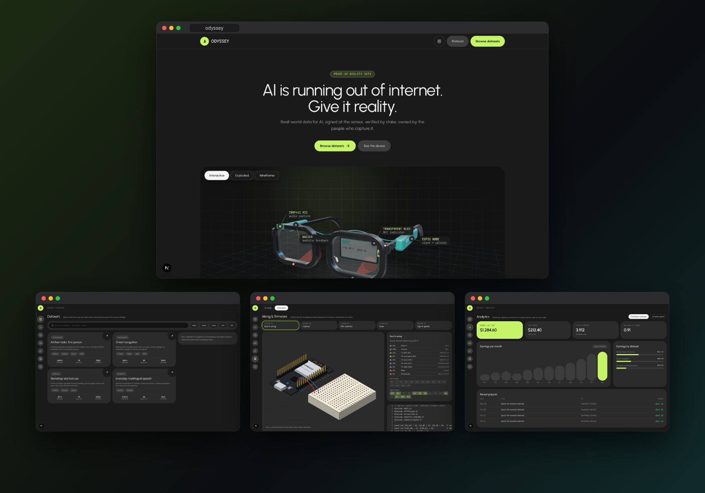
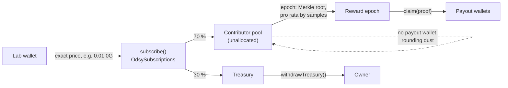
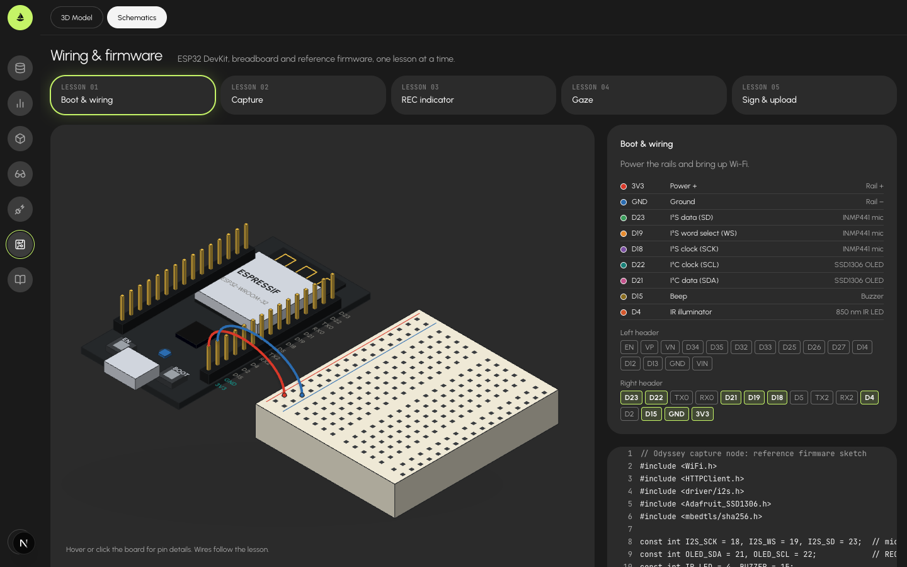
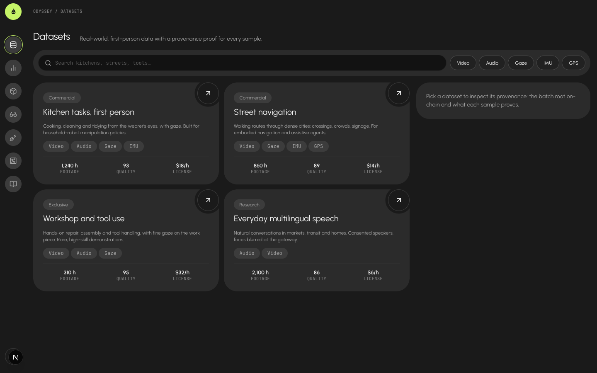
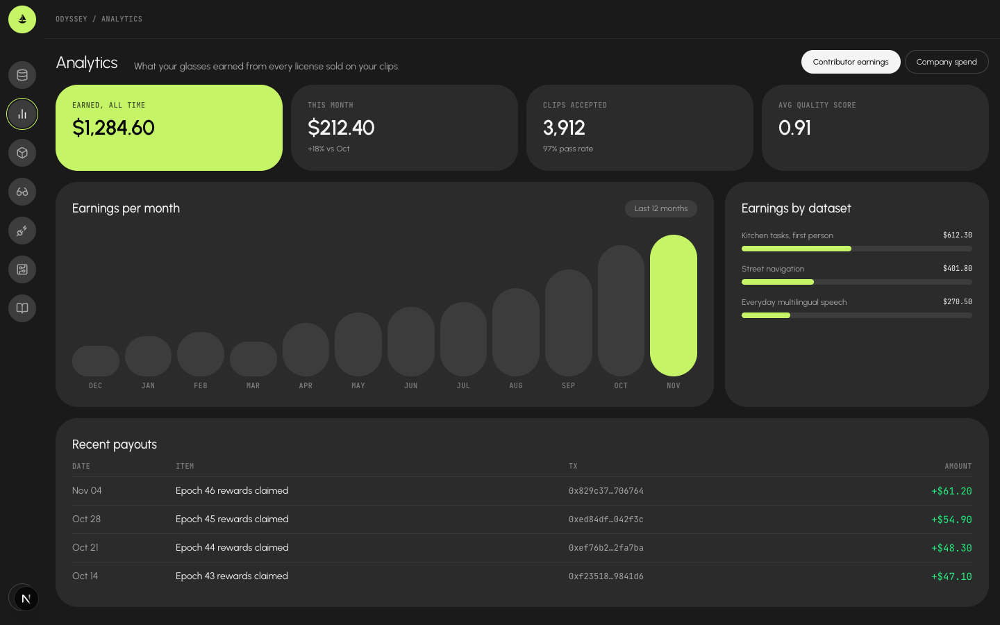

# Odsy · Proof-of-Reality Data

> **Real-world data for AI, signed at the sensor, verified by stake, owned by the people who capture it.**

AI is running out of internet. The next frontier models, especially robots and embodied agents, need **first-person, real-world data**: what a human sees, hears, looks at and does. That data is scarce, expensive, and today it is either scraped without consent or locked inside a few big labs.

Odsy turns every pair of glasses, every sensor and every phone into a **paid, verifiable data source**, and gives AI labs a dataset they can actually trust: every sample is traceable to a real device, a real human and a real moment, and nobody can quietly change it afterwards.



```
  capture ──► sign ──► filter ──► store ──► anchor ──► verify ──► pay
  (device)   (chip)    (TEE)      (0G)      (chain)    (stake)    (token)
```

---

## Why now

| The problem | Odsy's answer |
|---|---|
| Labs can't tell real data from synthetic or faked uploads | Each sample is signed by a hardware key inside the device at capture time |
| One person can run 1,000 fake devices | One human, one device: linked with World ID (Proof of Human) |
| Datasets get edited, poisoned or relabelled after the fact | Batch Merkle roots on-chain: any change breaks the proof |
| Checking every sample doesn't scale | Optimistic acceptance plus random, staked spot-checks of 1 to 5 % |
| Contributors give data away for free | Batched payouts: one Merkle root per epoch, each contributor claims with a proof |
| Immutable storage vs privacy law | Encrypted per batch; destroy the key to forget the data (crypto-shredding) |

---

## How it works

**1. Capture: trust starts at the sensor.**
Glasses (ESP32 + mic + IR camera + IMU) record short clips. A key in the secure element signs `hash · device · time · witnesses`. Nearby devices on the Bluetooth mesh can co-sign as witnesses.

**2. Filter: machines first, at machine speed.**
Gateways inside a TEE check the signature, duplicates (perceptual hash), format, blur and silence, and blur faces and plates. Most junk dies here, off-chain.

**3. Store: data off-chain, truth on-chain.**
Encrypted batches go to 0G Storage. One Merkle root per batch goes on-chain, so a million samples cost one transaction.

**4. Verify: optimistic, staked, random.**
Each batch opens a challenge window. A VRF-picked committee of staked validators scores a small random sample (commit-reveal, so nobody copies votes). Hidden honeypots grade the validators. Anyone can challenge with a bond.

**5. Pay: one root, many claims.**
Each epoch publishes a rewards Merkle root. Contributors claim with a proof.
`reward = base × quality score × rarity` is the design. Today the split is pro rata by sample count (see *Where the money goes*).

---

## Stake and slash

| Role | Stakes | Slashed for |
|---|---|---|
| **Contributor** | Nothing: World ID + device key is the spam filter | Never slashed; rewards withheld, device banned |
| **Gateway** | Medium | Anchoring a batch that hides bad or duplicate data |
| **Validator** | Medium | Failed honeypots, missed reveals, losing a challenge |
| **Challenger** | Bond per challenge | Frivolous challenges |

Slashing only happens on **objective evidence** (bad signature, duplicate, failed honeypot, proven fake), never on "the majority disagreed".

---

## Why it scales

- **On-chain cost is flat**: one root per batch, not one transaction per sample.
- **Verification grows with the sample, not the dataset**: 1 to 5 % is checked, and it's random, so cheaters can't know which.
- **No real-time coordination**: gateways and validators scale out independently.
- **Existing chain**: 0G Chain or an Ethereum L2. We build a data protocol, not a blockchain.

---

## What already exists in this repo

| Built today | Becomes |
|---|---|
| ESP32 glasses firmware, mic, IR camera, OLED | The capture device |
| open-iris + iris matcher | Owner check before a device can upload |
| World ID IDKit, "one human, one wallet" | Sybil resistance: one human, one device |
| 0G Storage uploads (memory notes) | Encrypted batch storage |
| 0G Compute rule engine (approve / hold) | TEE quality filter |
| EIP-3009 gasless token + relayer | Contributor payouts |
| Bluetooth mesh chunk protocol | Witness co-signing and offline upload |
| ENS device subnames (`glasses-xxxx.odsy.eth`) | Public device identity and reputation |
| Next.js server + MongoDB on Vercel | Gateway and coordinator MVP |
| Arkiv gateway + geohash index (`apps/web/app/api`) | Queryable, signed sample index; see below |

## Tracks

How the project maps to the sponsor tracks it targets. Each row says what is built, where it lives, and how to see it. Honest status is in the last column.

### Arkiv: the data layer

| What we built | Where | Status |
|---|---|---|
| Every sample is a readonly Arkiv entity (metadata, geohash, signature, encrypted payload up to 96 KiB) | `lib/schema.ts`, `app/api/ingest` | Live-tested on Rabdi |
| Device registry, datasets, paid periods and reward epochs as gateway-owned entities | `lib/schema.ts`, `app/api/devices`, `app/api/datasets`, `lib/rewards.ts` | Live-tested: registry, datasets. Rewards not yet run live |
| Geo search ("what was captured near here?") on a geohash index | `lib/geo.ts`, `lib/query.ts`, `app/api/samples` | Live-tested |
| Retention: extend only the samples worth keeping, let the rest and banned data expire | `app/api/cron/extend`, `lib/retention.ts` | Built, not run on a schedule yet |

See it: TESTING.md part 2, steps 2 to 4. Explore shows samples on the map straight from Arkiv.

### 0G: payments, contracts and storage

| What we built | Where | Status |
|---|---|---|
| `OdsySubscriptions` on Galileo: labs pay in 0G for 30-day dataset access, 70 % goes to contributors, Merkle reward claims | `contracts/src/OdsySubscriptions.sol`, `lib/contract.ts` | Deployed, 14 tests. Subscribe and claim not yet confirmed end to end |
| `ConsensusRegistry` on Galileo: hex-tile verdicts by validator median, two-strike ban | `contracts/src/ConsensusRegistry.sol`, `lib/consensus.ts` | Deployed, 10 tests, hand-run live |
| 0G Storage for payloads over 96 KiB, root kept on Arkiv | `lib/og.ts` | Built, not yet confirmed with a large payload |

See it: TESTING.md parts 2 and 3. Both contracts are linked under *Deployed contracts* below.

### World ID: one human, one device

| What we built | Where | Status |
|---|---|---|
| A device key is bound to a World ID nullifier, one device per human. The proof's signal is the device address, so one human's proof cannot enroll another device | `app/api/enroll`, `lib/arkiv.ts` (`registerDevice`), `Devices` schema | Built (World ID v4, RP-signed request, verified against the developer portal). Not yet live-tested by us |
| Every sample carries the World ID that captured it | `Samples.worldId` | Live |
| Two provable strikes ban a World ID: no uploads, no new device, data from its first strike unreadable | `ConsensusRegistry`, `lib/consensus.ts`, `lib/access.ts` | Built, contract run live, gateway path not yet end to end |

Enrollment is `/enroll`: sign in with a wallet, enter the glasses' address and MAC, approve in World App (or `simulator.worldcoin.org` with a staging app). The signed-in wallet becomes the device's payout address. `POST /api/devices` remains for an external registrar that verifies World ID itself (`REGISTRAR_TOKEN`). `/mockups/enroll` is only a demo of the flow. Setup: create an app and a `register-device` action at developer.world.org and set `WORLD_APP_ID`, `WORLD_RP_ID` and `WORLD_RP_SIGNING_KEY`. Design notes: [docs/odsy_provenance_network.md](docs/odsy_provenance_network.md).

## Deployed contracts

Both on 0G Galileo Testnet (chain ID 16602), deployed by the same testnet wallet, unaudited.

| Contract | Address | Deploy |
|---|---|---|
| `OdsySubscriptions` | [`0xc3a946516f2f0CE3fc2065543cb0a8E9b105A54e`](https://chainscan-galileo.0g.ai/address/0xc3a946516f2f0CE3fc2065543cb0a8E9b105A54e) | [tx](https://chainscan-galileo.0g.ai/tx/0xc83445b99003f52c1e12007bc8072edf5c95c54f7ae1b6cd4875b2c40f7ef980), block 64,085,686 |
| `ConsensusRegistry` | [`0x83bea227e5D2C72f8F0F73E63175759D4E6055DC`](https://chainscan-galileo.0g.ai/address/0x83bea227e5D2C72f8F0F73E63175759D4E6055DC) | [tx](https://chainscan-galileo.0g.ai/tx/0x032d1d358c84b4563dc39516c776d7198f0046f3b588ff7ed9db33490be12e34), block 64,080,632 |

`SUBSCRIPTIONS_ADDRESS` and `SUBSCRIPTIONS_FROM_BLOCK` are required by the gateway for any signed-in request. Without them `/api/datasets`, `/api/samples`, `/api/subscriptions` and `/api/rewards` return 500 with `Missing env SUBSCRIPTIONS_ADDRESS`.

## Where the money goes

Labs pay for datasets in 0G on Galileo. The contract splits every payment on the spot, and contributors collect their share by epoch.



**Worked example.** A lab pays **0.01 0G** for a dataset. The contract sets **0.007** aside for contributors and **0.003** for the treasury. The dataset holds samples from three devices: A has 60, B has 30, C has 10 and no payout wallet. When the owner publishes the epoch, A's wallet gets 0.0042, B's gets 0.0021, and C's 0.0007 stays in the pool for a later epoch.

| Step | Who | Money moves |
|---|---|---|
| Subscribe | Lab | Pays exactly the dataset price plus gas. Access lasts 30 days; renewals stack, up to 150 days prepaid |
| Split | Contract | `contributorBps` (7000 = 70 %) to the contributor pool, the rest to the treasury. The owner can change it, never below 50 %, for future payments only |
| Publish an epoch | Owner (`npm run rewards:publish`) | Splits the pool across payout wallets pro rata by each device's sample count, publishes one Merkle root. The contract refuses a total above the pool |
| Claim | Payout wallet, or anyone on its behalf | `claim(epoch, account, amount, proof)` pays the account. The claimer pays gas, and a root can never pay out more than its published total |
| Withdraw | Owner | `withdrawTreasury(to)` moves the treasury balance only, never contributor funds |

**What is not paid from this flow**
- **Gas** is paid by whoever sends the transaction: the lab to subscribe, the owner to set prices, publish epochs and withdraw, the claimer to claim.
- **Storage** is not paid from revenue. The gateway wallet pays Arkiv gas (tGLM) for every sample, registration and extension, and 0G Storage fees for large payloads, out of its own funds.
- **Validators are not paid yet.** The consensus contract has no rewards or staking, and its tile verdicts do not gate payouts. Rewards today follow subscriptions only.
- **Unclaimed money** stays in the contract: shares of devices without a payout wallet and rounding dust remain in the pool for a later epoch.

Code: `contracts/src/OdsySubscriptions.sol`, `lib/rewards.ts`, `scripts/publish-rewards.ts`.

## The web app

A Next.js app and gateway in `web-monorepo/apps/web`. Live pages talk to Arkiv and 0G Galileo and ask for a wallet sign-in. Everything under `/mockups` runs on demo data and needs no sign-in.

| Route | What it shows | Data |
|---|---|---|
| `/` | Landing page with the interactive 3D glasses | static |
| `/datasets`, `/datasets/{key}` | Dataset marketplace, paid subscriptions, sample hex map | live, wallet sign-in |
| `/explore` | Search samples by place on a map | live, wallet sign-in |
| `/activity` | Transactions, payments and contributor rewards | live, wallet sign-in |
| `/enroll` | Enroll glasses to a World ID and a payout wallet | live, wallet sign-in |
| `/capture` | A device's captures with signature and content-hash checks | live, wallet sign-in |
| `/admin` | List, grant and revoke admins | live, admin only |
| `/device` | 3D capture device: interactive, exploded, wireframe | static |
| `/wiring` | ESP32 wiring and reference firmware, one lesson at a time | static |
| `/docs` | Protocol docs | static |
| `/mockups` | Index of the demo screens below | demo |
| `/mockups/datasets` | Validator-consensus hex map | demo |
| `/mockups/analytics` | Contributor earnings and company spend | demo |
| `/mockups/devices` · `/mockups/enroll` | Registered devices and the enrollment flow | demo |

| Wiring & firmware | Datasets (mockup) | Analytics (mockup) |
|---|---|---|
|  |  |  |

The datasets and analytics screenshots predate the live pages and show the demo screens, now under `/mockups`.

Run it:

```bash
cd web-monorepo
npm install
npm run dev   # http://localhost:3000
```

## Directory structure

```
.
├── web-monorepo/  Web apps and services: Next.js gateway and coordinator, World ID, ENS, 0G, relayer, iris matcher
│   └── apps/web/   Site + Arkiv gateway: app/(app) pages (live + /mockups), app/api (ingest, devices, samples, datasets,
│                   subscriptions, keys, auth, cron), components (wallet, sign-in gate, skeletons, H3 map),
│                   lib (arkiv, geo, crypto, sessions, payments, 0G, sample protocol),
│                   scripts/simulate-device.ts (fake glasses), scripts/lab-ingest.ts (lab-side verified sync)
├── firmware/      ESP32 glasses: `odsy_glasses_camera` (camera capture, secp256k1 device key, signed upload) plus mic, IR, IMU and OLED sketches
├── contracts/     Foundry: OdsySubscriptions (subscriptions + reward claims) and ConsensusRegistry (tile verdicts, two-strike ban)
├── docs/          Screenshots used in this README and the provenance design note (odsy_provenance_network.md)
├── .claude/       Agent skills (Solidity security, OpenZeppelin, token checks)
├── .cursor/       Cursor rules (Ponytail)
├── AGENTS.md      Rules for AI coding agents
└── CLAUDE.md      Loads AGENTS.md for Claude Code
```

## Arkiv data layer (built)

The first working slice: a device signs each capture, the gateway checks it, **encrypts the payload**, and writes one **readonly entity per sample** to [Arkiv](https://docs.arkiv.network/) (Rabdi testnet). A geohash index on top of Arkiv answers "what was captured near here?". Labs sign in with their wallet, pay in test 0G for a 30-day dataset subscription, and only then get the keys to decrypt. Code: `web-monorepo/apps/web/{app,lib,components}`.

```
 device key signs ──► POST /api/ingest ──► payload ≤ 96 KiB ──► inline in the Arkiv entity
 sha256 + metadata       │ verify sig           payload > 96 KiB ──► 0G Storage, root on Arkiv
                         │ device registered?
                         │ contentHash unique?
                         └──► Arkiv entity (readonly, max lifetime) ◄── GET /api/samples (geo)
                                                                    ◄── daily /api/cron/extend
```

### What is stored per sample (`odsy.samples`)

| Column | Type | Indexed | Notes |
|---|---|---|---|
| `device` | addr | ✓ | Recovered from the device signature; the device's identity |
| `worldId` | str | ✓ | World ID nullifier bound to the device at registration |
| `deviceType`, `mac` | str | ✓ | From the device registry, not from the upload |
| `kind` | str | ✓ | `image`, `video`, `audio`, `text`, `sensor` |
| `capturedAt` | u64 | ✓ | Unix seconds, device clock |
| `lat`, `lon` | dec | ✓ | Decimal strings, signed exactly as stored |
| `geohash` | str | ✓ | Precision 9 (≈ 5 m) |
| `contentHash` | str | ✓ | sha256 of the plaintext payload; duplicates are rejected |
| `storage`, `ogRoot` | str | `storage` ✓ | `inline` or `0g` + 0G merkle root |
| `enc`, `sensorsHash` | str | | `aes-256-gcm-v1`; sha256 of the plaintext sensors JSON |
| `mime`, `size`, `sensors`, `signature`, `data` | — | | Stored, not indexed. `sensors` and `data` are ciphertext |

Devices live in `odsy.devices` (`device`, `worldId`, `deviceType`, `mac`). One World ID can bind one device. Datasets (`odsy.datasets`) and paid periods (`odsy.subscriptions`) are Arkiv entities too. Only entities owned by the gateway wallet are trusted, since anyone can write the same schema tag.

The device signs this text with EIP-191 (`lib/sample.ts`):
`odsy-sample:v1|<sha256(data)>|<kind>|<mime>|<capturedAt>|<lat>|<lon>|<sha256(sensors JSON)>`

### Encryption

Metadata stays public so the geo index, search and signature checks work for anyone. The payload and sensor readings are encrypted with AES-256-GCM before they reach Arkiv or 0G (`lib/crypto.ts`):

- Each sample gets its own key: `HKDF-SHA256(DATA_KEY, contentHash)`. Handing out one key reveals one sample, nothing else.
- `contentHash` is bound in as authenticated data, so ciphertext can't be moved to another sample.
- The gateway releases a sample's key, or decrypts it in the app, only to an admin or to a wallet whose active subscription covers that sample.
- Anyone can still check the device signature, because it is computed over `contentHash` and `sensorsHash`. Checking the payload against `contentHash` needs access.

`DATA_KEY` is the one secret that unlocks every sample. Back it up, and never change it: samples encrypted under an old key can't be read with a new one. Deleting it makes all data unreadable. That is the crypto-shredding path, not something to do by accident. Samples written before encryption shipped have no `enc` and stay public.

### The app: sign-in, datasets, payments, transactions

Wallet sign-in uses [Sign-In with Ethereum](https://eips.ethereum.org/EIPS/eip-4361) with any browser wallet such as MetaMask. The server checks the signed message's domain, nonce, expiry and signature, then sets a signed `httpOnly` session cookie for 7 days. Signing costs no gas. **Sign out** ends the session and also disconnects the site in the wallet (`wallet_revokePermissions`), so the next sign-in asks again. Wallets listed in `ADMIN_ADDRESSES` are root admins. Any admin can add or remove other admins on the **Admins** page (`/admin`): each grant is an `odsy.admins` entity written by the gateway (`admin`, `grantedBy`, `grantedAt`), so the list is public on Arkiv. Root admins can't be removed from the page, and nobody can remove their own wallet, so a bad grant can't lock everyone out. A change takes up to 10 seconds to apply on other server instances.

The live pages (Datasets, the dataset map, Explore and Transactions) show a **sign-in overlay** until a wallet signs in, over a blurred placeholder page. Landing, Protocol docs, Capture device, Wiring and everything under `/mockups` stay open. While data loads from Arkiv, pages show **skeleton placeholders** in the shape of the content.

| Page | Any signed-in wallet | Subscriber | Admin |
|---|---|---|---|
| **Datasets** (`/datasets`) | Browse datasets, preview sample metadata, subscribe with test 0G | Renew, see access-until date, lab-ingest snippet, open the map | Create datasets, list or unlist them |
| **Dataset map** (`/datasets/{key}`) | Subscribe prompt | H3 hexagon map of the dataset's samples: volume, kind and access per cell, linking into Explore | Same, for every dataset |
| **Explore samples** (`/explore`) | Search by dataset or area, kind and time; see metadata and the signature proof | Decrypt and view or download covered samples | Decrypt everything |
| **Transactions** (`/activity`) | Own 0G payments and contributor rewards to claim | Same | Every payment, every recent Arkiv write by the gateway |

**Paying.** A dataset is a saved filter (area, kind, device type, time range) plus a price in 0G per 30 days. Labs pay the **`OdsySubscriptions` contract** on **0G Galileo** (chain 16602, `contracts/`):

1. Creating a dataset lists it on the contract at its price (`setPrice`); unlisting sets the price to 0. Listing again also repairs a price that failed to set.
2. **Subscribe** calls `subscribe(datasetKey)` with exactly the price. The contract records `paidUntil` in the same transaction: renewals stack from the current `paidUntil`, up to 150 days ahead. The app switches or adds the network for you.
3. The gateway reads `paidUntil` from the contract to decide who gets decryption keys. Periods recorded on Arkiv before the contract shipped (`odsy.subscriptions`) stay valid until they lapse.

New samples that match a dataset are covered automatically.

### Contributor rewards

**70 %** of every payment is set aside for contributors and **30 %** goes to the treasury. The owner can change the split, but the contract never lets the contributor share fall below 50 %.

1. **Payout wallet.** Each device can have a payout wallet: its owner's wallet, never the key on the glasses. Set it at registration (`payout` in `POST /api/devices`) or later with `PATCH /api/devices`.
2. **Epochs.** An admin runs `npm run rewards:publish`. For every `Subscribed` event since the last epoch, it splits the dataset's contributor share across the dataset's samples, pro rata by device, to each device's payout wallet. It publishes one Merkle root with `publishRewards` and stores the leaves on Arkiv (`odsy.rewards`), plus a local copy in `apps/web/rewards/`.
3. **Claiming.** Contributors see their share under **Transactions → Contributor rewards** and click **Claim**. Anyone may call `claim()` for an account; the money always goes to that account.
4. **Safety limits.** The contract never pays more than an epoch's published total. The owner can only withdraw treasury revenue (`withdrawTreasury`), never contributor funds.

Shares for devices without a payout wallet, and rounding dust, stay unallocated in the contract.

### Geospatial index

Arkiv has no geo type, but it has string prefix search. Each sample stores a precision-9 geohash. For a radius query the API picks the finest geohash precision whose cells cover the circle's bounding box in at most 4 cells, sends `geohash STARTSWITH …` for each, then filters by exact haversine distance and sorts nearest first (`lib/geo.ts`).

### Retention and thinning

Arkiv entities live at most ~182 days, and nothing on Arkiv is permanent unless it is extended. `GET /api/cron/extend` (daily via `vercel.json`) does this:

1. Finds samples that expire within `EXTEND_WITHIN_DAYS`.
2. Groups them by device, by geohash cell at `THIN_GEOHASH_PRECISION`, and by `THIN_WINDOW_SECONDS` window.
3. Extends one sample per group to the maximum lifetime: the earliest capture, decided over all live samples in the group. The rest are left to expire.
4. Extends every device registration and dataset. Subscriptions expire on their own a week after `paidUntil`.

### For AI labs: ingest into your own warehouse

Arkiv keeps a sample for about 6 months, or longer if the gateway extends it. A lab doesn't need to rely on that: it runs `scripts/lab-ingest.ts` on its own schedule and keeps a permanent copy of the datasets it subscribes to.

The job signs in to the gateway with the paying wallet and asks it for one thing only: per-sample decryption keys (`POST /api/keys`). It reads all data and ciphertext straight from Arkiv and 0G, and trusts only the gateway's wallet address. For each new sample in its datasets it:

1. Takes it only if the Odsy gateway wrote it (`$owner` matches).
2. Gets the sample's key from the gateway, which grants it only while the subscription is active, and decrypts locally.
3. Checks the sensors against `sensorsHash`, then re-checks the device signature.
4. Checks that the device is registered to the stored World ID.
5. Downloads 0G media by its root, or reads inline data, and checks the decrypted payload's sha256 against `contentHash`.
6. Writes the sample to `lab-data/`.

```bash
ODSY_GATEWAY_ADDRESS=0x<gateway address> GATEWAY_URL=https://<odyssey app> \
LAB_PRIVATE_KEY=0x<paying wallet key> LAB_DATASETS=0x<dataset key>[,0x...] LAB_MODE=all npm run lab:ingest
```

Output in `lab-data/`:

| File | Contents |
|---|---|
| `samples.jsonl` | Verified samples, one per line, ready to load into a warehouse |
| `media/` | Payloads, named by content hash |
| `rejected.jsonl` | Samples that failed a check, with the reason |
| `dropped.jsonl` | Samples skipped in `thinned` mode |
| `state.json` | The sync cursor per dataset |

Runs are incremental. The cursor is `$expiresAt`: new and extended samples always have the latest one. A run that crashes never duplicates rows. A failed 0G download, or a sample whose key is refused because the subscription lapsed (`locked`), is retried on the next run.

**Policy: `LAB_MODE`**

| Mode | The lab gets | Note |
|---|---|---|
| `all` (default) | Every sample the gateway wrote | Must run more often than every ~182 days, or thinned-out samples expire before they're copied |
| `thinned` | One sample per device, geohash cell and time window: the same one the gateway keeps | Waits until a window closes plus `LAB_THIN_GRACE_SECONDS`. `THIN_GEOHASH_PRECISION` and `THIN_WINDOW_SECONDS` must match the gateway's |

`LAB_MODE` is a policy the lab chooses, not an access control. A subscriber gets keys for every sample its dataset covers, so `thinned` is honoured by the lab, not enforced. To enforce it, `POST /api/keys` would release keys only for the kept sample of each group.

### API

| Endpoint | Auth | Does |
|---|---|---|
| `GET /api/devices?device=` | Public | A device's registry entry and its newest samples |
| `GET /api/enroll`, `POST /api/enroll` | Signed in | The enroll page's signed World ID request, then `{device, mac, result}`: verifies the proof (signal = device address), refuses a banned World ID, registers the device with the wallet as payout |
| `POST /api/devices` | `Bearer REGISTRAR_TOKEN` | For an external registrar that verified World ID itself: binds `{device, worldId, deviceType, mac, payout?}`. `403` for a banned World ID |
| `PATCH /api/devices` | `Bearer REGISTRAR_TOKEN` | `{device, payout}`: set the wallet that receives a device's rewards |
| `POST /api/ingest` | Device signature | `{kind, mime, capturedAt, lat, lon, sensors, data (base64), signature}` → `201 {entityKey, txHash, contentHash, storage, ogRoot}`. `403` for an unregistered or banned device |
| `GET /api/samples?lat=&lon=&radius=&kind=&deviceType=&from=&to=&limit=` or `?dataset=` | Public (metadata) | Samples within `radius` metres (max 50 km) or in a dataset, nearest first. `readable` says whether the viewer can decrypt |
| `GET /api/samples/{key}` | Public, more with access | Metadata and the re-checked signature. With access, also the decrypted sensors and inline payload, and `verified.contentHash` |
| `GET /api/samples/{key}/data` | Access | Decrypted payload as a file (inline or from 0G), hash-checked |
| `GET /api/auth/nonce`, `POST /api/auth/verify`, `POST /api/auth/logout`, `GET /api/auth/me` | — | Sign-In with Ethereum session |
| `GET /api/datasets` | Public | Datasets with sample counts and the viewer's access-until date |
| `GET /api/admins`, `POST /api/admins`, `DELETE /api/admins?address=` | Admin | List admins (root and granted), make a wallet admin with `{address}`, or remove a granted one |
| `POST /api/datasets`, `PATCH /api/datasets/{key}` | Admin | Create a dataset and list it on the contract, or list/unlist it with `{active}` |
| `GET /api/subscriptions` | Signed in | Own payments from the contract's `Subscribed` events plus legacy Arkiv periods (admin: all) |
| `GET /api/rewards` | Signed in | The wallet's reward per epoch with its Merkle proof and claimed state |
| `POST /api/keys` | Signed in | `{keys: [...]}` → per-sample decryption keys the wallet is entitled to |
| `GET /api/activity` | Signed in | Recent Arkiv writes with tx hashes (admin: all; lab: own subscriptions). Only the last ~800 blocks (about 25 minutes), because the Arkiv RPC serves logs only for recent blocks |
| `POST /api/mcp/token` | Signed in | Mint a 7-day bearer token for the MCP server |
| `POST /api/mcp` | `Bearer` MCP token | MCP server: `list_datasets`, `search_samples`, `get_sample` |
| `GET /api/config` | Public | Subscriptions contract address and its chain |
| `GET /api/cron/extend` | `Bearer CRON_SECRET` | Retention job above |

### Setup

You need:

- **Node.js 22.10+** (the simulator and tests run TypeScript directly).
- **An Arkiv access key** from [hub.arkiv.network/access-keys](https://hub.arkiv.network/access-keys). The public RPC is heavily rate limited without one.
- **A gateway wallet funded with tGLM** from the [Arkiv faucet](https://hub.arkiv.network/faucet). Every sample, registration and extension is a transaction.
- **A 0G testnet wallet with tokens** ([faucet.0g.ai](https://faucet.0g.ai)) as `OG_PRIVATE_KEY`. It deploys and owns the subscriptions contract, and stores payloads over 96 KiB.
- **Foundry** for the contract: `curl -L https://foundry.paradigm.xyz | bash && foundryup`.
- **A browser wallet** (MetaMask or similar) with some Galileo test 0G, to sign in and pay. The app adds the Galileo network for you.
- **New secrets in `.env`:** `DATA_KEY` (`openssl rand -hex 32`, back it up), `SESSION_SECRET` (`openssl rand -hex 32`), `ADMIN_ADDRESSES` (your wallet address), and `SUBSCRIPTIONS_ADDRESS` plus `SUBSCRIPTIONS_FROM_BLOCK` from the deploy below, optionally `CONSENSUS_ADDRESS` (see *Consensus contract*), and `WORLD_APP_ID`, `WORLD_RP_ID`, `WORLD_RP_SIGNING_KEY` for `/enroll`.

Deploy the contract once:

```bash
cd contracts
git submodule update --init --recursive     # OpenZeppelin Contracts + forge-std
forge test                                  # 14 tests, fuzzing included
forge script script/DeploySubscriptions.s.sol --rpc-url galileo --broadcast --private-key $OG_PRIVATE_KEY
# put the printed address in SUBSCRIPTIONS_ADDRESS, and the deploy block in SUBSCRIPTIONS_FROM_BLOCK
```

Datasets created before the contract need listing on it: in the app, **Unlist**, then **List dataset for sale**.

```bash
cd web-monorepo
npm install
cp apps/web/.env.example apps/web/.env      # fill every uncommented value
npm run dev                                 # gateway on http://localhost:3000
npm run simulate -- 3                       # fake glasses: register, upload 3 signed samples from Bandra, query nearby
npm run simulate -- 1 ./photo.jpg           # an image > 96 KiB goes through 0G
npm run simulate -- 3 --kind sensor         # weather readings (kind=sensor, application/json)
npm test                                    # geo, thinning, signature, encryption, session, reward-split tests (no network)
npm run lab:ingest                          # with the LAB_* vars set: pull your datasets into apps/web/lab-data/
npm run rewards:publish -- --dry-run        # preview the next reward epoch; drop --dry-run to publish it
```

Generate a key with:

```bash
node -e "import('viem/accounts').then(a=>{const k=a.generatePrivateKey();console.log(k,a.privateKeyToAccount(k).address)})"
```

### Known gaps (read before trusting the data)

- **Tamper-evident, not tamper-proof.** Samples are created `readonly`, so nobody can patch them. The gateway wallet can still delete them, and they expire if the extend job stops. For permanence, anchor a Merkle root per batch on a long-lived chain (Roadmap Phase 1).
- **The gateway is trusted.** It holds the key that writes everything and `DATA_KEY`, which decrypts everything. Anyone can re-check a sample's device signature, but a compromised gateway could refuse uploads, delete samples or leak data.
- **The paywall covers payloads, not metadata.** Location, time, device, MAC and World ID are public on Arkiv by design, because they power the geo index. A subscriber who saves the keys or data keeps them after the subscription ends.
- **The contract owner is trusted with rewards.** Payments and access are enforced on-chain. The reward split is computed off-chain, though, and the owner key publishes the roots. A wrong root can misdirect up to that epoch's total, but never the treasury or other epochs. There are no refunds. Only externally owned wallets can sign in, not smart-contract wallets.
- **The contracts aren't audited.** They're tested (24 Foundry tests: 14 for subscriptions, including fuzz and reentrancy cases, and 10 for consensus). Run the repo's `solidity-auditor` skill and an external review before any real money.
- **Mockups live under `/mockups`** and show demo data only: `/mockups/datasets` (the validator-consensus hex map), `/mockups/analytics`, `/mockups/devices` and `/mockups/enroll`. They are marked "mockup" in the nav and top bar. The live routes are `/datasets`, `/datasets/{key}`, `/explore`, `/activity`, `/enroll`, `/capture`, `/admin` and `/api/*`.
- **Explorer links** assume `/tx/<hash>` paths on chainscan-galileo.0g.ai and rabdi.explorer.arkiv.network.
- **Device keys are only as safe as the device.** Real glasses need the key in a secure element (ATECC608A) or ESP32 flash encryption. A key in plain NVS can be copied.
- **Location is hard-coded to Bandra, Mumbai**, because there is no GPS yet. Even with GPS, a signed location is only as honest as the device; witness co-signing (see *How it works*) is the planned check.
- **World ID is verified in `/api/enroll`, not in `POST /api/devices`.** The latter trusts its caller through `REGISTRAR_TOKEN`, so keep that token secret or leave it unset. The enroll flow needs `WORLD_APP_ID`, `WORLD_RP_ID` and `WORLD_RP_SIGNING_KEY`, and has not been run live by us.
- **Privacy.** MAC addresses and World ID nullifiers are public on Arkiv. Images can show bystanders. Before real users: hash or drop the MAC and blur faces at the gateway. Immutable personal data also conflicts with GDPR and DPDP deletion rights. Per-sample keys make crypto-shredding possible, by destroying `DATA_KEY`, but only for all samples at once.
- **Live-tested so far:** device registration, plaintext and encrypted ingest (text and sensor samples), geo queries, wallet sign-in, dataset creation and the lab ingest job's sign-in and dataset lookup, all against Arkiv Rabdi. Not yet confirmed end to end on live networks: a paid subscription unlocking decryption, lab ingest writing decrypted files, payloads over 96 KiB on 0G, the Transactions log, the retention job, and the subscriptions contract on Galileo (deploy, subscribe, publish and claim rewards).
- **Scale shortcuts** are marked `shortcut:` in code. The geo scan stops at 2,000 candidates. Duplicate and registration checks can race. The extend job runs in a single request.

## MCP server: query your datasets from an LLM

Subscribers can search and read the data they paid for from Claude, Cursor, ChatGPT's API or any other MCP client, with a bearer token. It is retrieval only: the model you connect does the answering, and it can only see what your wallet has subscribed to.

**Get a token.** Sign in on the Datasets page, open the *Use your datasets in an AI tool* card and click **Create token**. It shows a copy-paste setup for Claude Code, Cursor, Claude Desktop and any other client. The server is hosted, so a new user installs and clones nothing: no local path, no runtime, only a token (Claude Desktop also needs Node.js for the bridge). Tokens last 7 days and are shown once.

**Endpoint:** `POST /api/mcp` (MCP streamable HTTP, stateless, JSON replies), header `Authorization: Bearer <token>`.

| Tool | Does |
|---|---|
| `list_datasets` | Your active subscriptions: key, name, area, access end |
| `search_samples` | Keyword search (BM25) over the text and sensor samples of one dataset, with optional time range. Returns the best matches with a snippet, location, time and content hash |
| `get_sample` | One sample in full, decrypted, if a subscription covers it |

Connect a client:

```bash
# Claude Code
claude mcp add --transport http odyssey https://<your-host>/api/mcp --header "Authorization: Bearer <token>"
```

No `claude` command installed (for example inside the desktop app)? Use the project file instead. This repo already has a token-free [`.mcp.json`](.mcp.json): export your token, then start Claude Code in the repo and approve the server.

```bash
export ODYSSEY_TOKEN=<token>
# optional: point at your own deployment instead of the default
export ODYSSEY_URL=https://<your-host>
```

```json
// Cursor: .cursor/mcp.json
{ "mcpServers": { "odyssey": { "url": "https://<your-host>/api/mcp", "headers": { "Authorization": "Bearer <token>" } } } }
```

- **Claude Desktop** only launches local commands, so use the `mcp-remote` bridge (needs Node.js; `npx` fetches it). In `claude_desktop_config.json`:

  ```json
  { "mcpServers": { "odyssey": {
      "command": "npx",
      "args": ["-y", "mcp-remote", "https://<your-host>/api/mcp", "--header", "Authorization:${ODYSSEY_AUTH}"],
      "env": { "ODYSSEY_AUTH": "Bearer <token>" } } } }
  ```
- **ChatGPT and the OpenAI API:** the Responses API takes an MCP tool with `server_url` and `headers`. ChatGPT's own connector screen asks for OAuth, which this server does not offer yet.
- **Anything else:** any MCP client that speaks HTTP and can set a header.

Access is the same check as the web app (`readAccess`): the wallet's active subscriptions, a banned World ID's data excluded, admins see everything. Code: `lib/mcp-core.ts` (tokens, ranking, JSON-RPC), `lib/mcp.ts` (tools), `app/api/mcp`.

**Limits.** Keyword search only, no embeddings, so "car" will not find "vehicle". It ranks the newest 100 text and sensor samples of a dataset per query. Images, audio and video, and payloads stored on 0G, are not returned. Tokens cannot be revoked, only expire (rotating `SESSION_SECRET` kills them all). No rate limiting yet, and no OAuth.

## Consensus contract

`contracts/src/ConsensusRegistry.sol` decides whether a neighbourhood of data is good, and bans bad actors.

### Deployed (0G Galileo testnet)

| | |
|---|---|
| Contract | [`0x83bea227e5D2C72f8F0F73E63175759D4E6055DC`](https://chainscan-galileo.0g.ai/address/0x83bea227e5D2C72f8F0F73E63175759D4E6055DC) |
| Network | 0G Galileo Testnet, chain ID 16602 |
| Deploy tx | [`0x032d…2e34`](https://chainscan-galileo.0g.ai/tx/0x032d1d358c84b4563dc39516c776d7198f0046f3b588ff7ed9db33490be12e34), block 64,080,632 |
| Rules fixed at deploy | quorum 6667 (two thirds), committee 3, min sample rate 100 (1%), min checks 3, strike limit 2 |
| Admin / operator | `0x51f18a28F4C17121770782aC95B9baAf6257053a` (one testnet wallet; use a multisig for admin before real money) |

This is a testnet deployment, unaudited, with throwaway validators, and the source is not verified on the explorer. Redeploy before using it for anything real, because the rules cannot change in place.

### In plain words

The map is cut into hexagons. For each hexagon and each day (a *tile*) we spot-check a few random clips, like a teacher checking a few pages of homework.

1. Too few clips or devices in the hexagon? It waits.
2. Otherwise validators check a handful of clips and each says how many passed. The middle answer wins.
3. If two thirds passed, the tile is accepted. If not, it is rejected. (Payouts are meant to follow accepted tiles, but today they do not: rewards come from subscriptions, see *Where the money goes*.)
4. **Two strikes:** a device caught with *provable* bad data twice (fake signature, copied clip, failed honeypot, impossible location) gets its World ID banned. Its data from the first strike onward is left out. Being outvoted is never a strike. Admins can lift a ban.

### How the gateway uses it

The gateway reads and writes the contract with the same 0G wallet as the subscriptions contract (`OG_PRIVATE_KEY`, the operator). Set `CONSENSUS_ADDRESS` in `web-monorepo/apps/web/.env`; if it is unset nobody is ever banned. Code: `web-monorepo/apps/web/lib/consensus.ts`.

| Where | What happens for a banned World ID |
|---|---|
| `POST /api/ingest` | `403`: no new uploads |
| `POST /api/devices` | `403`: cannot register a new device |
| Sample reads, `/api/samples/{key}/data`, `POST /api/keys` | Samples captured from its first strike on are not decryptable, even with a subscription. Admins still see everything |
| `GET /api/cron/extend` | Its samples are not extended, so they expire |
| Strike source today | One: a clip whose hash another World ID already uploaded (`replay`). The same device retrying is not a strike |

Bans are cached for 60 seconds per server instance. Validators, tile submission and voting are not driven by the app yet: use `cast` (see below).

### Settings

Shared rules are fixed at deploy from env vars (copy `contracts/.env.example` to `contracts/.env`). Each dataset picks its own within them.

| Env var | Plain meaning | Default |
|---|---|---|
| `QUORUM_BPS` | Share of checked clips that must pass (6667 = two thirds) | 6667 |
| `COMMITTEE_SIZE` | Validator votes needed per tile | 5 (3 on the testnet deploy) |
| `MIN_SAMPLE_RATE_BPS` | Lowest spot-check rate a dataset may choose (100 = 1%) | 100 |
| `MIN_CHECKS` | Every tile gets at least this many checks | 3 |
| `STRIKE_LIMIT` | Alerts before a ban | 2 |
| `ADMIN` / `OPERATOR` | Who can lift bans and add validators / the gateway wallet | required |

Per dataset (`createDataset`): hex size (H3 res 6 to 10), time bucket, minimum clips and devices, check rate, pass mark.

### Deploy your own

```bash
cd contracts
git submodule update --init --recursive
forge test                                   # 24 tests: 14 subscriptions + 10 consensus
cp .env.example .env                         # set ADMIN and OPERATOR (and COMMITTEE_SIZE)
forge script script/Deploy.s.sol --rpc-url galileo --private-key $OG_PRIVATE_KEY            # dry run
forge script script/Deploy.s.sol --rpc-url galileo --private-key $OG_PRIVATE_KEY --broadcast
```

Then put the printed address in `CONSENSUS_ADDRESS`.

### Try it by hand

```bash
A=<contract address>; R="--rpc-url galileo --private-key $OG_PRIVATE_KEY"
# add a validator (the validator needs a little 0G for gas)
cast send $A "grantRole(bytes32,address)" $(cast keccak VALIDATOR) <validator> $R
# create a dataset: hex res 8, 1-day tiles, min 20 clips and 3 devices, 3% checked, pass mark 70
cast send $A "createDataset(bytes32,(uint8,uint32,uint32,uint32,uint16,uint8,bool))" <dataset key> "(8,86400,20,3,300,70,false)" $R
# submit a tile (cell, epoch, root, clips, devices), then each validator votes how many checked clips passed
cast send $A "submitTile(bytes32,uint64,uint64,bytes32,uint32,uint32)" <dataset key> 1 20000 0x…01 400 5 $R
cast send $A "vote(bytes32,uint32)" <tile id> 10 --rpc-url galileo --private-key <validator key>
# two alerts ban a World ID, then check
cast send $A "raiseAlert(bytes32,bytes32,bytes32)" <worldId> $(cast format-bytes32-string replay) <ref> $R
cast call $A "isBanned(bytes32)(bool)" <worldId> --rpc-url galileo
```

### How it was tested

Ten Foundry tests, plus a run on the live deployment: three validators voted 10 of 12 checked clips as passed on a 400-clip tile and it ended Accepted, two alerts banned a test World ID, and `lift` cleared it. The gateway wiring is type-checked and builds but is not yet exercised end to end.

### Limits of this first version

Validators are an allowlist with one vote each (no staking, commit-reveal or challenges yet). Rules cannot change without redeploying. Only the `replay` strike is raised automatically; honeypot failures and validator outcomes are not connected. The contract is not audited.

## Roadmap

- [ ] **Phase 1: Prove it.** Device signing, upload to 0G, batch roots on-chain, test-token rewards. The team does the spot-checks.
  - [x] Signed device uploads, device registry with World ID binding, encrypted storage on Arkiv and 0G
  - [x] Geo search, paid dataset subscriptions on 0G Galileo, lab ingest with local decryption
  - [x] Subscription contract with a 70 % contributor split and Merkle reward claims
  - [ ] Batch Merkle roots on a long-lived chain, real glasses with GPS
- [ ] **Phase 2: Stake it.** Permissioned staked validators, honeypots, challenge window, slashing.
  - [x] `ConsensusRegistry` on Galileo: tile verdicts by validator median, two-strike World ID ban, enforced by the gateway
  - [ ] Validator staking and slashing, commit-reveal, honeypots, challenge window, more automatic strike sources
- [ ] **Phase 3: Open it.** Permissionless validators, TEE gateways, rarity rewards, buyer marketplace with licensing.
- [ ] **Phase 4: Value it.** Reward data by how much it actually improves a model.

---

## For AI labs

Buy datasets with a **provenance proof per sample**: the device that captured it, the verified human behind it, when and where, its validation score, and a Merkle proof that it hasn't changed since. Clear consent and licensing travel with every batch.

## For contributors

Wear it, capture your world, get paid. Your data is encrypted, your identity stays private (World ID reveals nothing about who you are), and you can revoke it.

---

<sub>Status: **testnet prototype**. The Arkiv data layer, encryption, dataset subscriptions and lab ingest are built (see *Arkiv data layer*), with payments and contributor rewards on the `OdsySubscriptions` contract; validation and staking are still design. The app's Protocol page (`/docs`) shows what's live next to the full design. Numbers (1–5 % sampling, challenge windows) are starting assumptions to tune against measured fraud rates.</sub>
