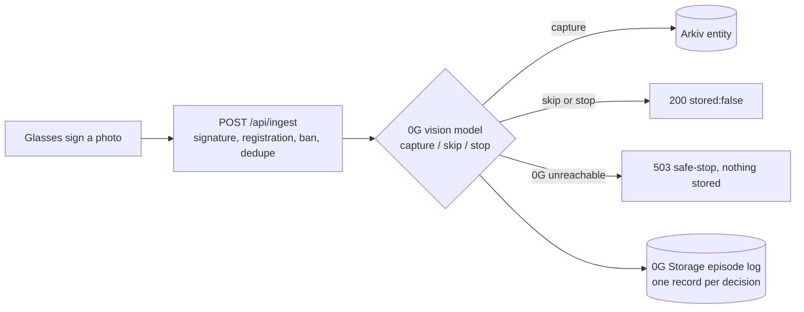

# Prize requirements: what is built, where, and what is still ours to do

Two prizes are targeted: **0G Physical AI** and **World Best Use of IDKit**. We do not enter Agents That Pay, Keep Building or any Continuity track.

## 0G Physical AI: the capture gate

**Idea.** The glasses are the physical agent. Every image a device uploads is judged by a vision model on 0G Private Computer before anything is stored: `capture` (store it), `skip` (completely black or dark image, e.g. a covered lens; the ESP camera is low-res black and white, so blurry or grainy images are kept) or `stop` (must not be recorded: close-up face, private screen, ID or payment card). The judge runs inside `POST /api/ingest`, so a glasses firmware only has to call the endpoint it already calls.

| Requirement | How it is met | Where |
|---|---|---|
| A 0G call inside the decision loop | Each image upload calls `POST {OG_COMPUTE_BASE_URL}/chat/completions` and acts on the answer | `lib/gate-core.ts`, `app/api/ingest/route.ts` |
| Episode log on 0G Storage, with a request id per decision | One JSON record per decision (device, content hash, action, reason, model, provider, `x_0g_trace.request_id`, TEE flag, outcome) uploaded with `uploadTo0G`; the root is returned as `episodeRoot` | `lib/gate.ts` (`logEpisode`) |
| Replayable | `npm run replay:gate -- path/to/images` signs and uploads images in order and writes `episodes.jsonl` | `scripts/replay-gate.ts` |
| Safe-stop if 0G is unreachable | Timeout, 402, 429, 502, 503, or an unparseable answer all become `GateUnavailable`; the API returns `503` and stores nothing. There is no local fallback decision | `lib/gate-core.ts`, covered by `lib/gate-core.test.ts` |

**What breaks if 0G is removed:** the gateway can no longer tell a usable photo from a black one or a private one, so it either stores everything or (as built) refuses every image upload with a 503.

**Scope notes (honest).** Only `image` uploads are gated. Text, sensor, audio and video uploads pass through unchanged. The episode log holds hashes and the decision, never the image. A skipped or stopped image is judged once and not retried. The gate is on only when `OG_COMPUTE_API_KEY` is set.

**Optional labelling (`OG_LABELS=true`, default off).** The same model call also returns a `scene` from a fixed list (street, indoor, nature, shop, vehicle, crowd, other). A valid tag is stored as the optional `scene` attribute on the Arkiv sample and shown in `/api/samples` and `/api/samples/<key>`; an invalid or missing tag is left out rather than guessed. The tag is the gateway's attestation, not part of the device signature, and it is not indexed or usable as a dataset filter yet. Older samples have none.

### Still ours to do (cannot be done from code alone)

- [ ] Get a key at pc.0g.ai (Dashboard, API Keys) and deposit 0G. Set `OG_COMPUTE_API_KEY` in `.env` and on Vercel.
- [ ] Check the real model id with `GET {base}/models` and set `OG_COMPUTE_MODEL` if `qwen2.5-vl-72b-instruct` is not listed.
- [ ] Run one live image. Unverified until then: the router accepting `image_url` data URLs, and the `verify_tee` field. If it rejects `verify_tee`, set `OG_COMPUTE_VERIFY_TEE=false`.
- [ ] Record the demo: replay images including a fully black one (covered lens) and a private one, then switch the key off or break the URL to show the safe-stop.
- [ ] Submission: README and setup (done), demo video under 3 minutes, live demo link, contract addresses (README, *Deployed contracts*), team contacts.

## World Best Use of IDKit

IDKit is the `/enroll` page (`app/(app)/enroll/page.tsx`) and `POST /api/enroll`, which verifies the proof against `developer.worldcoin.org` on the server.

**The trust moment.** Registering a device. Everything downstream (rewards paid to a wallet, the 30 % treasury split, the two-strike ban) assumes one human behind each device. Without that, one person can register a hundred devices and farm rewards.

**Why this credential is the minimum sufficient one.** We need exactly one fact: this is a unique human who has not enrolled a device before. We do not need a name, age, nationality or document. The preset is `orbLegacy`, which yields a per-app nullifier: the same human always produces the same nullifier for the `register-device` action, and different apps cannot link them. That nullifier is all we store (as `worldId`). *Review this paragraph before submitting: confirm against current World docs that this is the weakest credential that still guarantees uniqueness.*

**The proof is bound to the device.** The signal is the device address, so a proof captured for one device cannot enroll another.

| Path | What the user sees | Code |
|---|---|---|
| Success | Device registered, signed-in wallet becomes the payout wallet | `app/api/enroll/route.ts` |
| User cancels or IDKit errors | Banner `World ID error: <code>`; nothing is registered, they can retry | `enroll/page.tsx` (`onError`) |
| Proof rejected by World | `400 World ID rejected the proof: <detail>` | `enroll/route.ts` |
| Proof for another device or wrong environment | `400` (signal mismatch, staging vs production) | `enroll/route.ts` |
| Human already has a device | `409` | `enroll/route.ts` |
| Device already registered | `409 device already registered` | `enroll/route.ts` |
| Banned human | `403 this World ID is banned` | `enroll/route.ts` |

### Still ours to do

- [ ] Run `/enroll` once end to end with a staging app and simulator.worldcoin.org (not live-tested yet), then once with a cancel and once with a duplicate, for the demo video.
- [ ] Fill in the debrief below from that real run. It must be your actual experience, not ours.

### Integration debrief (fill in after the live run)

- Time to first success: ___ minutes (from creating the app at developer.world.org to a verified proof)
- Friction we hit: ___
- Docs that were missing or unclear: ___
- The one improvement we would ask World to make: ___
