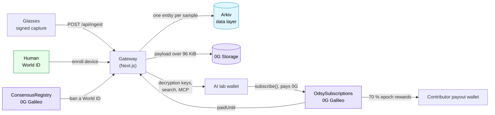
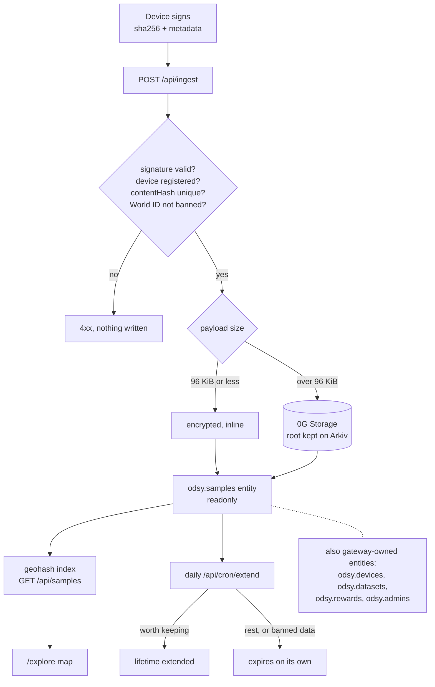
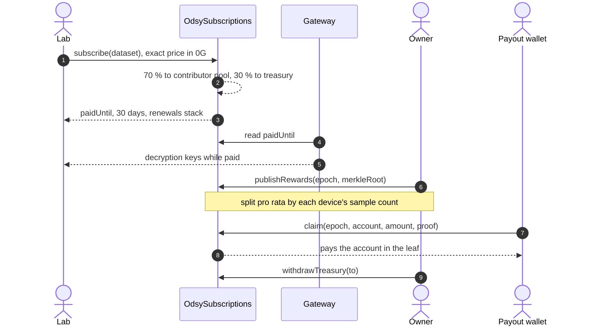
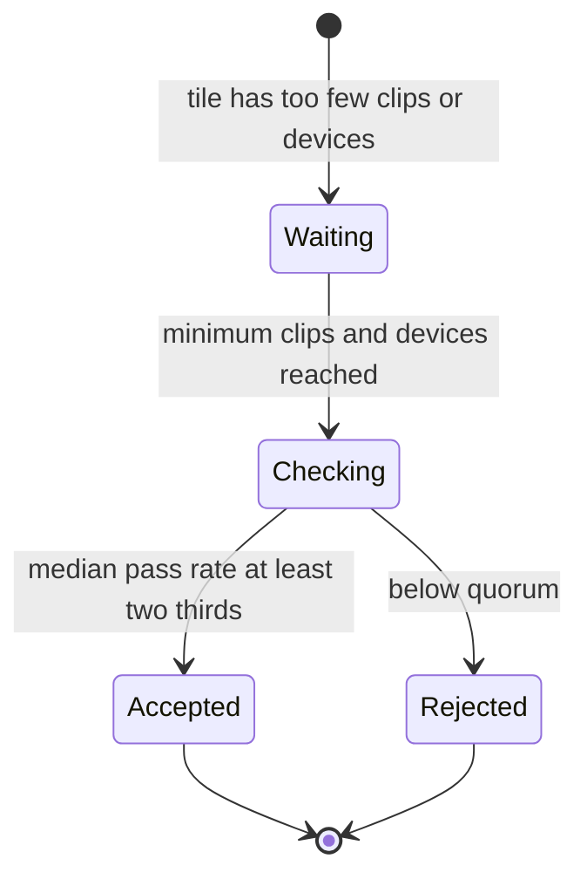
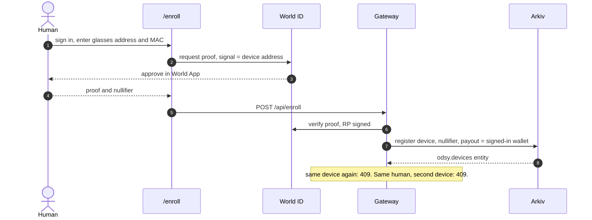
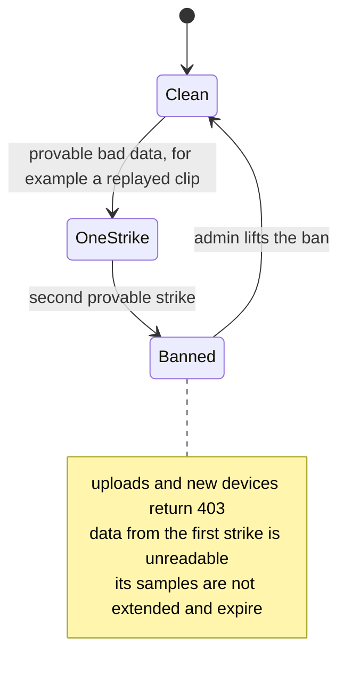

# Track-wise guide

Odsy targets three sponsor tracks: **Arkiv**, **0G** and **World ID**. Each one is a layer of the same product, not a separate demo. This guide walks one track at a time: the idea, a diagram, what to click or run to see it, where the code is, and what is honestly not done.

- Short version of the mapping: [README, Tracks](../README.md#tracks).
- Full run-through with every command: [TESTING.md](../TESTING.md).
- Design background: [odsy_provenance_network.md](odsy_provenance_network.md).

## The product in one picture

A pair of glasses signs what it captures. The gateway checks the signature, stores the sample on Arkiv, and a lab pays on 0G to read it. World ID makes sure one human cannot flood the network with devices.

| Track | Its job in the product | Where to start |
|---|---|---|
| [Arkiv](#arkiv-the-data-layer) | Holds every sample, device, dataset and reward epoch as a queryable entity | `/explore` |
| [0G](#0g-payments-contracts-and-storage) | Takes the money, splits it, stores big payloads, judges neighbourhoods of data | `/datasets`, `/activity`, `/analytics` |
| [World ID](#world-id-one-human-one-device) | Binds each device to one human and bans a human after two proven strikes | `/enroll` |

---

## Arkiv: the data layer

**The idea.** Arkiv is the database. Every capture becomes one **readonly entity** with its metadata, a geohash, the device signature and the encrypted payload (up to 96 KiB inline). Devices, datasets, reward epochs and admin grants are gateway-owned entities too, so the whole state is public and queryable.

**What it proves.**
- Every sample is a first-class Arkiv entity, not a row in a private database.
- "What was captured near here?" is a real query (geohash index), not a table scan.
- Retention is policy, not deletion: keep what is worth keeping, let the rest expire.

**See it.**
1. `npm run simulate -- 5` sends five signed samples ([TESTING.md part 2, step 2](../TESTING.md#2-gateway-subscriptions-and-rewards)).
2. Open `/explore`, search 19.0596, 72.8295 with a 1 km radius. The samples appear on the map straight from Arkiv.
3. `/activity` as an admin lists the recent Arkiv writes with transaction links (the RPC only serves about the last 25 minutes of logs).

**Code.** `lib/schema.ts`, `app/api/ingest`, `app/api/samples`, `lib/geo.ts`, `lib/query.ts`, `app/api/cron/extend`, `lib/retention.ts` (all under `web-monorepo/apps/web`).

**Status.** Samples, registry, datasets and geo search are live-tested on Rabdi. Reward epochs have not been run live. The retention cron is built but not scheduled yet.

---

## 0G: payments, contracts and storage

**The idea.** 0G Galileo is where money and judgement live. Three pieces:

1. **`OdsySubscriptions`** takes a lab's payment, splits it 70 / 30 on the spot, and lets contributors claim with a Merkle proof.
2. **`ConsensusRegistry`** decides whether a hexagon of data for a day is good, by the median of validator checks, and tracks strikes.
3. **0G Storage** holds payloads too big for an Arkiv entity.

### Money

Worked example: a lab pays 0.01 0G. 0.007 goes to the pool, 0.003 to the treasury. With devices A (60 samples), B (30) and C (10, no payout wallet), A gets 0.0042, B gets 0.0021, and C's 0.0007 stays in the pool. The full table is in the README under [Where the money goes](../README.md#where-the-money-goes).

### Consensus

Validators vote how many of their checked clips passed, the median wins, and a tile needs at least two thirds. A device caught with **provable** bad data (fake signature, copied clip, failed honeypot, impossible location) gets a strike. Being outvoted is never a strike. The strike-to-ban path is in the [World ID section](#world-id-one-human-one-device).

**See it.**
1. As admin, create a dataset on `/datasets` (listing it sets its price on the contract).
2. As a lab wallet, subscribe with 0.01 0G. Payloads unlock and `/activity` shows 0.007 0G to contributors.
3. `npm run rewards:publish`, then sign in as the payout wallet and Claim on `/activity`. A second claim reverts with `AlreadyClaimed`.
4. `/analytics` shows the same money as earnings per epoch and spend per dataset.
5. Consensus is driven by hand with `cast` ([TESTING.md part 3](../TESTING.md#3-consensus-contract-and-the-ban)).
6. Subscribers can also query what they paid for from Claude or Cursor through the MCP server ([TESTING.md part 5](../TESTING.md#5-mcp-server)).

**Contracts** (0G Galileo, chain 16602, unaudited testnet deploys):

| Contract | Address |
|---|---|
| `OdsySubscriptions` | [`0xc3a9…A54e`](https://chainscan-galileo.0g.ai/address/0xc3a946516f2f0CE3fc2065543cb0a8E9b105A54e) |
| `ConsensusRegistry` | [`0x83be…55DC`](https://chainscan-galileo.0g.ai/address/0x83bea227e5D2C72f8F0F73E63175759D4E6055DC) |

**Code.** `contracts/src/OdsySubscriptions.sol`, `contracts/src/ConsensusRegistry.sol`, `lib/contract.ts`, `lib/rewards.ts`, `lib/consensus.ts`, `lib/og.ts`, `scripts/publish-rewards.ts`.

**Status.** Both contracts are deployed with tests (14 and 10) and the consensus contract was run by hand live. A subscribe and claim round trip and a large 0G Storage payload have not been confirmed end to end. Validators are not paid or staked yet, and tile verdicts do not gate payouts today.

---

## World ID: one human, one device

**The idea.** Spam protection without staking: a device key is bound to a World ID **nullifier**, so one human can enroll one device. The proof's signal is the device address, so a proof made for one device cannot enroll another. Two provable strikes ban the World ID itself, not just a key.

### Strikes and bans

Every sample carries the World ID that captured it (`Samples.worldId`), so a ban can reach back to the first strike and hide that data.

**See it.**
1. Set the World ID variables ([README, World ID](../README.md#world-id-one-human-one-device)); use a staging app with `simulator.worldcoin.org`.
2. Open `/enroll`, enter a device address and MAC, approve in World App or the simulator. The device appears on `/capture` with your wallet as payout.
3. Enroll the same device again (`409 already registered`), or the same human for a second device (`409 already has a device`).
4. After a ban ([TESTING.md part 3c](../TESTING.md#3c-two-strikes-ban-a-human-through-the-gateway)), enrolling returns `403`.

**Code.** `app/api/enroll`, `lib/arkiv.ts` (`registerDevice`), the `Devices` schema, `ConsensusRegistry`, `lib/consensus.ts`, `lib/access.ts`.

**Status.** Built on World ID v4 with an RP-signed request, verified against the developer portal, but not yet live-tested by us. The ban contract was run live; the gateway path is not yet end to end. The only automatic strike today is a clip whose hash another World ID already uploaded.

---

## Known gaps across all tracks

- Subscribe and claim, a large 0G Storage payload, and World ID enrollment are built but not yet confirmed end to end on testnet.
- Validators are throwaway and unstaked, and consensus verdicts do not gate payouts. Rewards follow subscriptions only.
- Contracts are unaudited testnet deploys; redeploy before using them for real money.
- Retention runs only when `/api/cron/extend` is called.
- The MCP server is keyword search only, tokens last 7 days and cannot be revoked, and there is no OAuth.

The live list of limits is in the README under [Known gaps](../README.md#known-gaps-read-before-trusting-the-data).
