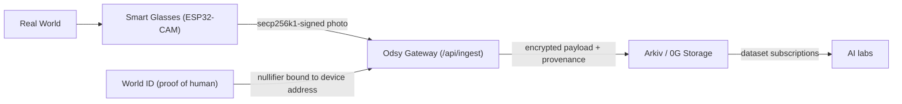
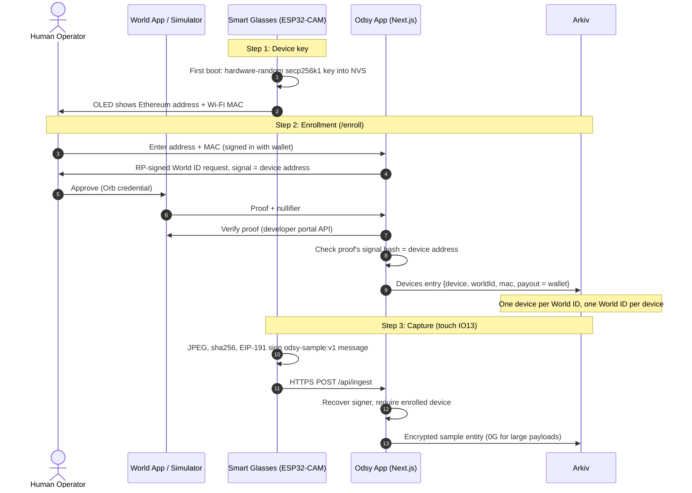

# Odsy: Verified Physical-World Data Network for AI

**A Cryptographic Provenance & Anti-Poisoning Architecture for Real-World AI Training**

---

## 1. Executive Summary

As artificial intelligence models scale, they face an existential crisis: **Model Collapse and AI Data Poisoning**. The public internet is increasingly saturated with synthetic, machine-generated images, deepfakes, and automated bot farm content. When frontier AI models train on synthetic data, their output quality degrades.

**Odsy** is a decentralized physical-world data network. Human operators wearing smart glasses capture real-world photos that AI developers can buy as datasets.

Every sample is bound by two cryptographic anchors:
1. **Hardware anchor:** a secp256k1 private key generated by the glasses' hardware RNG and kept in their flash (NVS). It signs every photo, and the gateway rejects anything not signed by an enrolled key.
2. **Human anchor (World ID):** a zero-knowledge proof that one unique human approved this exact device address. One human can enroll one device, which blocks bot farms and Sybil attacks.



---

## 2. System Architecture & The Trust Chain

### A. The Poisoning Attack Vector
In an open data marketplace, malicious actors have strong incentives to:
* Spin up 10,000 headless scripts feeding generated AI images to farm token rewards.
* Inject adversarial, perturbed images into computer vision datasets to back-door self-driving or robotics models.

### B. The Dual-Anchor Defense Mechanism



1. **Hardware key:** on first boot the ESP32 fills a secp256k1 private key from its hardware RNG and stores it in NVS. Its address is `keccak256(pubkey)[12:]`, the same as an Ethereum wallet's.
2. **Signal-bound World ID proof:** the device address is the World ID `signal`. The server checks the proof's `signal_hash` matches the address being enrolled, so a proof cannot be reused for another device.
3. **Sybil resistance:** the registry refuses a second device for the same nullifier.
4. **Signed samples:** every photo is signed over `odsy-sample:v1|contentHash|kind|mime|capturedAt|lat|lon|sensorsHash` (see `web-monorepo/apps/web/lib/sample.ts`). Anyone can recheck a stored sample's signature with `GET /api/samples/{key}`.

---

## 3. Hardware Architecture & Pin Configuration

The prototype is an **AI-Thinker ESP32-CAM** with a **0.96" SSD1306 OLED**.

```
                      ESP32-CAM Header Pinout
                             ┌─────────┐
                             │ Camera  │
                             └─────────┘
                         5V  [ ]     [ ]  3V3  ─────────> OLED VCC
                        GND  [ ]     [ ]  GND  ─────────> OLED GND
                       IO12  [ ]     [ ]  IO0  ─────────> Boot Mode (GND to flash)
     Capture trigger ─ IO13  [ ]     [ ]  IO16
        OLED SDA <───  IO15  [ ]     [ ]  IO3 (U0R) ───> RX on Programmer
        OLED SCL <───  IO14  [ ]     [ ]  IO1 (U0T) ───> TX on Programmer
                        IO2  [ ]     [ ]  VCC
                        IO4  [ ]     [ ]  GND
```

| Pin | Peripheral | Purpose | Hardware Constraints |
| :--- | :--- | :--- | :--- |
| **IO13** | Touch / button | Capture trigger (internal pull-up, touch to GND) | Shared with the SD slot; leave the SD card out. |
| **IO15** | OLED SDA | I2C data (port 0) | Custom pin to avoid the camera bus. |
| **IO14** | OLED SCL | I2C clock (port 0) | Custom pin to avoid the camera bus. |
| **IO21 / IO22**| Camera Sensor | Camera data (`Y5`) and pixel clock (`PCLK`) | Reserved for the camera. Must not be claimed by I2C. |
| **IO0** | Camera Sensor / Flash | Camera master clock (`XCLK`) | Grounded during flashing; floating/high in operation. |
| **5V / GND** | Power Supply | 3.7V LiPo via 5V step-up boost | Needs at least 1A transient peaks. |

---

## 4. Firmware (`firmware/odsy_glasses_camera/`)

* **`odsy_glasses_camera.ino`:** boots Wi-Fi and NTP, loads or creates the device key, shows the address and MAC on the OLED until the first touch, then runs a live OLED viewfinder. Touching IO13 grabs the frame (160x120 grayscale), encodes a JPEG, signs it and POSTs it to `/api/ingest` as JSON. The OLED shows `SAVED + SIGNED` (201), `NOT ENROLLED` (403) or the HTTP error.
* **`odsy_crypto.h`:** keccak-256, Ethereum address derivation and recoverable low-s ECDSA (EIP-191 `personal_sign`) on top of the mbedtls bundled with the ESP32 Arduino core.
* **`test/`:** a PC self-check that runs the same crypto code and has viem recover every signature (instructions at the top of `test/crypto_test.cpp`).

Settings at the top of the sketch: Wi-Fi credentials, `ingestUrl` (the deployed app, or `http://<laptop-ip>:3000/api/ingest` for local dev), and `DEVICE_LAT` / `DEVICE_LON`. The glasses have no GPS, so every sample is signed with that fixed location.

Requires the ESP32 Arduino core 3.x (mbedtls 3.6 with secp256k1 enabled) and the Adafruit SSD1306 and GFX libraries.

---

## 5. Gateway (Next.js, `web-monorepo/apps/web`)

Every request is self-contained, so the gateway runs on Vercel.

| Endpoint | Purpose |
| :--- | :--- |
| `GET /api/enroll` | Signed-in wallet only. Returns a fresh RP-signed World ID request context (`WORLD_APP_ID`, `WORLD_RP_ID`, `WORLD_RP_SIGNING_KEY`). |
| `POST /api/enroll` | Verifies the World ID proof with World, checks its signal is the device address, and registers the device on Arkiv with the wallet as payout address. |
| `GET /api/devices?device=0x..` | Public registry entry and the device's newest samples. |
| `POST /api/ingest` | Device upload: recovers the signer, requires an enrolled device, encrypts the payload, writes an Arkiv sample (0G for payloads over 96 KiB). |
| `GET /api/samples/{key}` | Sample metadata with re-checked signature. Admins, dataset subscribers and the device's owner also get the decrypted image. |

---

## 6. Operational Guide

1. **World ID app:** in the World developer portal, create a staging app (`app_staging_…`) with an action named `register-device`, and set `WORLD_APP_ID`, `WORLD_RP_ID` and `WORLD_RP_SIGNING_KEY` in `.env.local` (see `.env.example`).
2. **Flash the glasses:** set Wi-Fi, `ingestUrl` and location in the sketch, flash, and note the address and MAC on the OLED (also on the serial monitor at 115200 baud).
3. **Enroll:** open `/enroll`, sign in with your wallet, enter the address and MAC, click **Verify with World ID**, and approve the request in [simulator.worldcoin.org](https://simulator.worldcoin.org) with an Orb credential.
4. **Capture:** touch IO13. The photo appears on `/capture?device=<address>` within a few seconds, with its signature checked by the server.
